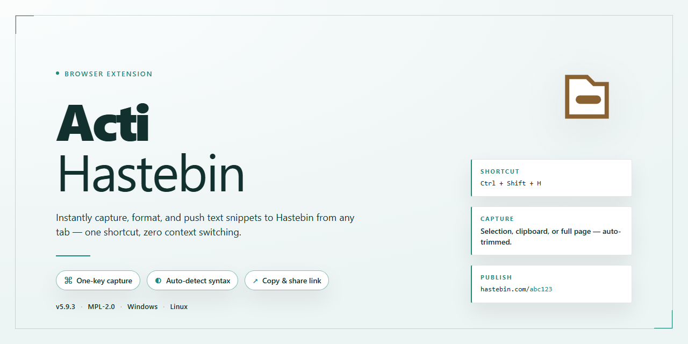

# ⚡ ActiHastebin: Clipboard-to-Hastebin Link Switcher for Chrome & Firefox

### ⌨️ PowerShell Command Button

  

---

ActiHastebin is an Activator listener that swaps the current clipboard text for a Hastebin link containing the previous clipboard content. Triggering the listener captures whatever is on the clipboard, uploads it, and replaces it with the resulting link in a single action. This keeps snippets, logs, and other shared text one gesture away from being pasted elsewhere.

## 📋 System Requirements

- Windows 10 or Windows 11
- PowerShell 5.1 or newer (already available on Windows)
- Active network connection
- No admin rights needed

## Features

- Intercepts the system clipboard action before it completes
- Uploads the previous clipboard text to Hastebin and receives a shareable link
- Replaces the clipboard contents with the returned Hastebin link
- Leaves clipboard behavior unchanged when no detectable text is present
- Works alongside existing Activator gestures without additional configuration
- Operates silently in the background with no visible interface

## How it works

ActiHastebin listens for your configured activation gesture and reads the current clipboard text. It creates a new paste on the Hastebin service containing that text, then replaces the clipboard contents with the resulting link. The original text is preserved on the paste, so nothing is lost when the clipboard is overwritten. After the swap, you can paste the link anywhere you would normally paste, and the source text remains accessible at the generated address.

## Privacy

ActiHastebin operates entirely on-device. Clipboard contents are read only when you trigger the Activator action, and the previous clipboard text is sent directly to Hastebin solely to create the link you requested. No clipboard data is stored, logged, or transmitted anywhere else by the extension. No analytics, tracking, or telemetry are included. The extension requests only the permissions required to read and replace clipboard contents and to reach Hastebin for link creation.

## FAQ

**Does this replace the clipboard or append to it?**  
It replaces the current clipboard contents with the Hastebin link. The original text is what gets uploaded, so nothing is lost — the link points back to it.

**What happens if the upload fails?**  
The clipboard is left untouched. No partial or error content is written, so your existing text stays available for retry.

**Does it work with non-text clipboard content?**  
No. Only plain text clipboard contents are handled. Images, files, and rich formats are ignored.

**Can I trigger it without Activator?**  
The listener is designed around Activator gestures. Invoke it through any Activator action you assign to it.

**Is any content stored locally?**  
No. The clipboard text is sent to create the Hastebin link and is not retained by the extension afterward.

**Does it require configuration?**  
No setup beyond assigning an Activator gesture. It works out of the box with default behavior.

**What happens to the previous clipboard after switching?**  
It is replaced by the generated link. There is no built-in history or undo — copy the original again if you need it back.

**Does it interfere with other clipboard tools?**  
It only reads and writes the clipboard when triggered by its Activator action, so normal clipboard use is unaffected between invocations.

## License

ActiHastebin is released under the MIT License. You are free to use, modify, and distribute the extension, including for commercial purposes, provided the original copyright notice and permission notice are included in all copies or substantial portions of the software. The software is provided "as is", without warranty of any kind, express or implied.